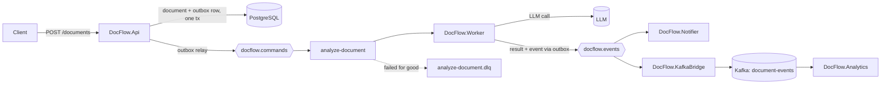

# DocFlow

[](https://github.com/Rujoker/docflow/actions/workflows/ci.yml)

Async legal-document analysis pipeline on .NET. A user uploads a document (privacy policy, terms of service), the API accepts it immediately, and the slow LLM analysis runs in the background through a message broker.

Why a broker here: an LLM call takes seconds and regularly fails with 429 / 529, so it can't live inside an HTTP request. The focus is on what it takes to make that reliable: no lost messages, no duplicate side effects, retries without hammering the provider, and a place for messages that will never succeed. Each failure mode is reproduced on purpose and documented.

> **Status:** work in progress. See [Roadmap](#roadmap).

## Stack

| Area | Tech |
| --- | --- |
| Runtime | .NET 10, ASP.NET Core minimal API, Worker Service |
| Messaging | RabbitMQ 4 (quorum queues), Kafka 4 (KRaft) |
| Persistence | PostgreSQL 17, EF Core |
| Reliability | Transactional outbox / inbox, idempotent consumers, Polly, DLX-based delayed retry, DLQ |
| Framework comparison | MassTransit v8 (separate branch) |
| Testing | xUnit, Testcontainers |
| Observability | OpenTelemetry, Jaeger |
| CI | GitHub Actions |

## Architecture (target)



Today only the solution skeleton and infrastructure exist; the rest lands milestone by milestone.

## How to run

Prerequisites: .NET 10 SDK, Docker Desktop.

```bash
docker compose up -d      # RabbitMQ + PostgreSQL
docker compose ps         # both containers should be running
dotnet build
```

| Service | URL | Credentials |
| --- | --- | --- |
| RabbitMQ management UI | http://localhost:15672 | `guest` / `guest` |
| RabbitMQ AMQP | `localhost:5672` | `guest` / `guest` |
| PostgreSQL | `localhost:5432` | `docflow` / `docflow`, db `docflow` |

Postgres shell without a separate client:

```bash
docker compose exec postgres psql -U docflow
```

Stop everything (`-v` also wipes broker and database data):

```bash
docker compose down        # keep data
docker compose down -v     # start from scratch
```

## LLM provider

The worker analyzes documents with an `ILlmClient`. Two implementations ship with the repo:

| Provider | What it does | When to use |
| --- | --- | --- |
| `Fake` (default) | Simulated analysis with 1–3 s latency. Markers in the text trigger failures on demand: `#transient`, `#always-down`, `#poison` | Experiments and tests, no API key, no cost |
| `Claude` | Real analysis through the [Anthropic C# SDK](https://platform.claude.com/docs/en/api/sdks/csharp) | Seeing the pipeline on real documents |

Switching to Claude:

1. Get an API key in the [Claude Console](https://platform.claude.com/) and set a spending limit there.
2. Store the key outside the repository — either as a user secret:

   ```bash
   dotnet user-secrets set "Anthropic:ApiKey" "sk-ant-..." --project src/DocFlow.Worker
   ```

   or as an environment variable: `export ANTHROPIC_API_KEY=sk-ant-...`.
3. Run the worker with the provider switched:

   ```bash
   Llm__Provider=Claude dotnet run --project src/DocFlow.Worker
   ```

   The startup log shows which provider is active. If `Claude` is selected without a key, the worker refuses to start.

Model and response size are configured in `src/DocFlow.Worker/appsettings.json` (`Llm:Model`, `Llm:MaxTokens`; default `claude-haiku-5-5`).

The SDK's built-in retries are switched off (`MaxRetries = 0`): retries are handled once, in the worker's own pipeline (Polly + broker-level delayed retry). Leaving both on would multiply the number of paid calls per document — see [docs/experiments/04-error-handling.md](docs/experiments/04-error-handling.md).

Error mapping: 429, 5xx (including 529 Overloaded), 408, 409 and network errors become transient and are retried; 400 and 422 mean the document itself was rejected and go straight to the DLQ.

## Repository layout

```
src/
  DocFlow.Contracts/   message contracts shared by all services
  DocFlow.Api/         document intake (HTTP)
  DocFlow.Worker/      document analysis (background consumer)
tests/
  DocFlow.Tests/       integration tests
samples/               test documents, including failure triggers
docs/experiments/      failure scenarios: what was expected, what happened, why
storage/               uploaded files (git-ignored)
```

## Sample documents

`samples/` holds fictional documents for manual testing. Some carry markers that the fake LLM client reacts to, so failure paths can be reproduced on demand. See [samples/README.md](samples/README.md).

## Roadmap

Each milestone is tagged, so a tag shows the project at that step.

| Version | Milestone | Status |
| --- | --- | --- |
| [v0.1.0](https://github.com/Rujoker/docflow/tree/v0.1.0) | Solution skeleton, docker-compose, CI | ✅ Done |
| [v0.2.0](https://github.com/Rujoker/docflow/tree/v0.2.0) | RabbitMQ topology: exchanges, bindings, durability | ✅ Done |
| [v0.3.0](https://github.com/Rujoker/docflow/tree/v0.3.0) | Document intake and analysis over RabbitMQ.Client | ✅ Done |
| [v0.4.0](https://github.com/Rujoker/docflow/tree/v0.4.0) | Reliable publishing: publisher confirms, persistent messages, `mandatory` | ✅ Done |
| [v0.5.0](https://github.com/Rujoker/docflow/tree/v0.5.0) | Transient vs permanent errors: Polly, DLX delayed retry, DLQ | ✅ Done |
| v0.6.0 | Transactional outbox | ⏳ |
| v0.7.0 | Idempotent consumer (inbox), domain events, Notifier | ⏳ |
| v0.8.0 | MassTransit v8 variant for comparison (branch `masstransit`) | ⏳ |
| v0.9.0 | Integration tests with Testcontainers | ⏳ |
| v0.10.0 | Distributed tracing with OpenTelemetry and Jaeger | ⏳ |
| v0.11.0 | Kafka for analytics: partitioning, consumer groups, replay | ⏳ |
| v1.0.0 | Delivery guarantees write-up | ⏳ |

## Notes on scope

Deliberate simplifications to keep the focus on messaging: API and Worker share one database (in production each service would own its data), files are stored in a local folder instead of S3 / Blob Storage, and brokers run as single nodes without a cluster.
