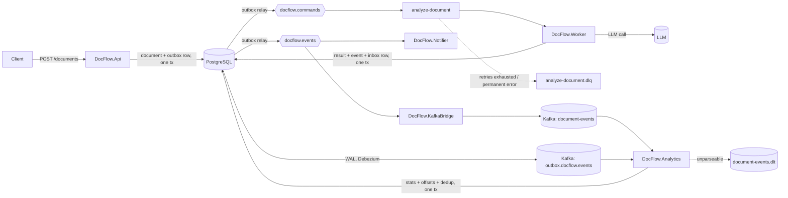
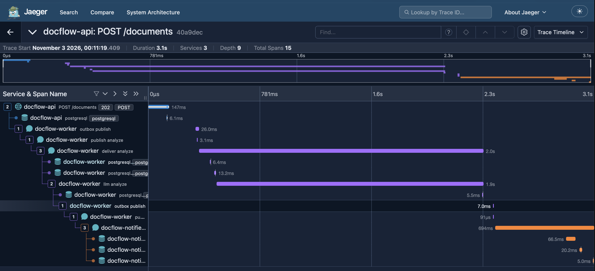

# DocFlow

[](https://github.com/Rujoker/docflow/actions/workflows/ci.yml)

Async legal-document analysis pipeline on .NET. A user uploads a document (privacy policy, terms of service), the API accepts it immediately, and the slow LLM analysis runs in the background through a message broker.

Why a broker here: an LLM call takes seconds and regularly fails with 429 / 529, so it can't live inside an HTTP request. The focus is on what it takes to make that reliable: no lost messages, no duplicate side effects, retries without hammering the provider, and a place for messages that will never succeed. Each failure mode is reproduced on purpose and documented in [docs/experiments](docs/experiments).

## Stack

| Area | Tech |
| --- | --- |
| Runtime | .NET 10, ASP.NET Core minimal API, Worker Service |
| Messaging | RabbitMQ 4 (quorum queues), Kafka 4 (KRaft) |
| Change data capture | Debezium on Kafka Connect, PostgreSQL logical replication |
| Persistence | PostgreSQL 17, EF Core |
| Reliability | Transactional outbox / inbox, idempotent consumers, Polly, DLX-based delayed retry, DLQ, DLT |
| Framework comparison | MassTransit v8 (branch `masstransit`) |
| Testing | xUnit, Testcontainers |
| Observability | OpenTelemetry, Jaeger |
| CI | GitHub Actions |

## Architecture



- **Commands** (`AnalyzeDocument`) go through RabbitMQ: each is a unit of work that needs a per-message ack, delayed retries, a DLQ and load balancing across workers.
- **Events** (`DocumentAnalyzed`, `DocumentFailed`) fan out through a topic exchange to the Notifier and to Kafka.
- **Analytics** reads Kafka because it needs history: it can recompute everything with a replay, and a new consumer gets past events without any change on the producer side.
- Events reach Kafka two ways — the RabbitMQ bridge and Debezium reading the WAL. Both can run at once; Analytics counts each event once. See [10b](docs/experiments/10b-debezium-dedup.md).

## Delivery guarantees

| Hop | Guarantee | How |
| --- | --- | --- |
| API → PostgreSQL | Atomic | The document and its `outbox_messages` row are written in one `SaveChangesAsync` |
| Outbox → RabbitMQ | At-least-once | `OutboxRelay` polls with `FOR UPDATE SKIP LOCKED`, publishes with publisher confirms, marks rows only after the confirm; `MessageId` = outbox row id, so a resend is recognizable |
| RabbitMQ → Worker | At-least-once | Quorum queues, persistent messages, manual ack after the database commit |
| Worker processing | Effect exactly once | Inbox (`processed_messages` per consumer) + document state check + unique key at commit. The LLM call itself can repeat after a crash before the commit |
| Failures | Bounded retries | Polly (2 in-process retries) inside broker-level delayed retry (3 × 10 s via DLX and a TTL queue), then the DLQ with the error type and attempt count |
| Worker → events | At-least-once | The worker's own outbox, written in the same transaction as the result |
| Events → Notifier | Effect exactly once | `processed_messages` with consumer `notifier` |
| RabbitMQ → Kafka (bridge) | At-least-once | RabbitMQ ack only after the Kafka ack; `acks=all`, idempotent producer |
| Outbox → Kafka (Debezium) | At-least-once | Replication slot keeps WAL until the connector confirms it; insert-only publication filtered to events; heartbeat table keeps the slot advancing |
| Kafka → Analytics | Effect exactly once | Dedup by `message-id`, stats and next offset in one PostgreSQL transaction; on assignment the consumer seeks to the stored offsets. Unparseable records go to `document-events.dlt` |

Delivery is at-least-once everywhere; duplicates are made harmless by idempotent consumers rather than prevented.

## Failure scenarios tested

| Scenario | Result | Notes |
| --- | --- | --- |
| Unroutable message | Rejected with `NO_ROUTE` instead of dropped silently | [03](docs/experiments/03-reliable-publishing.md) |
| Broker down during upload | Before the outbox: 503 and an orphan file (dual write). With the outbox: uploads accepted, delivered after recovery | [03](docs/experiments/03-reliable-publishing.md), [05](docs/experiments/05-transactional-outbox.md) |
| Cost of publisher confirms | ~15× slower when awaiting each confirm (308 vs 20 ms per 1000) | [03](docs/experiments/03-reliable-publishing.md) |
| Dependency that never recovers | 4 broker attempts × 3 Polly attempts = 12 paid LLM calls per document, ~1 min to the DLQ | [04](docs/experiments/04-error-handling.md) |
| Poison message | Straight to the DLQ, no retries | [04](docs/experiments/04-error-handling.md) |
| Crash between publish and commit | Resent with the same `MessageId`, skipped by the inbox | [05](docs/experiments/05-transactional-outbox.md), [06](docs/experiments/06-idempotent-consumer.md) |
| Two relays on one outbox | Each row published once with `SKIP LOCKED`; duplicates with a plain `SELECT` | [05](docs/experiments/05-transactional-outbox.md) |
| One bad row in an outbox batch | Head-of-line blocking; events now published without `mandatory` | [05](docs/experiments/05-transactional-outbox.md), [08](docs/experiments/08-integration-tests.md) |
| Crash after the LLM call, before commit | One result, but the call is paid twice | [06](docs/experiments/06-idempotent-consumer.md) |
| Two workers race for one message | Unique key at commit keeps one result; two paid calls | [06](docs/experiments/06-idempotent-consumer.md) |
| Subscriber down | Events buffered in its queue and delivered later | [06](docs/experiments/06-idempotent-consumer.md) |
| Outbox breaks the trace | Fixed by storing `traceparent` on the outbox row | [09](docs/experiments/09-tracing.md) |
| Hot partition, consumers > partitions | Constant key puts everything in one partition; extra consumers idle | [10](docs/experiments/10-kafka-analytics.md) |
| Slow handler in Kafka | `max.poll.interval.ms` exceeded → rebalance, commit fails, redelivery loop | [10](docs/experiments/10-kafka-analytics.md) |
| Poison record in Kafka | Crash loop that blocks the partition; fixed with a dead-letter topic | [10](docs/experiments/10-kafka-analytics.md) |
| Replay | Full history recomputed; nothing lost or duplicated end to end | [10](docs/experiments/10-kafka-analytics.md), [10b](docs/experiments/10b-debezium-dedup.md) |
| Bridge and Debezium at once | Every event arrives twice, counted once | [10b](docs/experiments/10b-debezium-dedup.md) |
| Debezium initial snapshot | Re-published 42 historical events; 6 genuinely new were counted | [10b](docs/experiments/10b-debezium-dedup.md) |
| Connector down, quiet captured table | Slot lag grew and stalled at ~85 kB; fixed with a heartbeat table | [10b](docs/experiments/10b-debezium-dedup.md) |

## Two implementations

The branch [`masstransit`](https://github.com/Rujoker/docflow/compare/main...masstransit) replaces the hand-written RabbitMQ code with MassTransit 8 (the last Apache-2.0 major version). Notes: [07](https://github.com/Rujoker/docflow/blob/masstransit/docs/experiments/07-masstransit.md).

- 169 lines added, 671 removed in `src`: topology, publisher, outbox relay and inbox are replaced by the EF Core outbox/inbox and retry/redelivery middleware.
- Same guarantees, same numbers: 12 LLM calls for a dependency that never recovers, duplicates stopped by the inbox.
- The trade: less code to own, but behavior moves into configuration. The order of `UseDelayedRedelivery` and `UseMessageRetry` decides whether calls multiply, and exchange names come from type names, so renaming a contract's namespace changes the topology.

## How to run

Prerequisites: .NET 10 SDK, Docker Desktop.

```bash
docker compose up -d      # RabbitMQ, Kafka, Kafka Connect, PostgreSQL, Jaeger
dotnet build
dotnet ef database update --project src/DocFlow.Persistence --startup-project src/DocFlow.Api
```

Each service in its own terminal:

```bash
dotnet run --project src/DocFlow.Api
dotnet run --project src/DocFlow.Worker
dotnet run --project src/DocFlow.Notifier
dotnet run --project src/DocFlow.KafkaBridge
dotnet run --project src/DocFlow.Analytics
```

Upload a document and check its status:

```bash
curl -F "file=@samples/policy-1.txt" http://localhost:5102/documents
curl http://localhost:5102/documents/<documentId>
```

Debezium is optional; setup in [infra/debezium](infra/debezium/README.md).

| Service | URL | Credentials |
| --- | --- | --- |
| API | http://localhost:5102 | — |
| RabbitMQ management UI | http://localhost:15672 | `guest` / `guest` |
| PostgreSQL | `localhost:5432` | `docflow` / `docflow`, db `docflow` |
| Kafka | `localhost:9092` | — |
| Kafka Connect (Debezium) REST | http://localhost:8083 | — |
| Jaeger UI | http://localhost:16686 | — |

Integration tests start their own containers:

```bash
dotnet test
```

Stop everything (`-v` also wipes broker and database data):

```bash
docker compose down        # keep data
docker compose down -v     # start from scratch
```

## LLM provider

The worker analyzes documents with an `ILlmClient`. Two implementations ship with the repo:

| Provider | What it does | When to use |
| --- | --- | --- |
| `Fake` (default) | Simulated analysis with 1–3 s latency. Markers in the text trigger failures on demand: `#transient`, `#always-down`, `#poison` | Experiments and tests, no API key, no cost |
| `Claude` | Real analysis through the [Anthropic C# SDK](https://platform.claude.com/docs/en/api/sdks/csharp) | Seeing the pipeline on real documents |

Switching to Claude:

1. Get an API key in the [Claude Console](https://platform.claude.com/) and set a spending limit there.
2. Store the key outside the repository — either as a user secret:

   ```bash
   dotnet user-secrets set "Anthropic:ApiKey" "sk-ant-..." --project src/DocFlow.Worker
   ```

   or as an environment variable: `export ANTHROPIC_API_KEY=sk-ant-...`.
3. Run the worker with the provider switched:

   ```bash
   Llm__Provider=Claude dotnet run --project src/DocFlow.Worker
   ```

   The startup log shows which provider is active. If `Claude` is selected without a key, the worker refuses to start.

Model and response size are configured in `src/DocFlow.Worker/appsettings.json` (`Llm:Model`, `Llm:MaxTokens`; default `claude-haiku-5-5`).

The SDK's built-in retries are switched off (`MaxRetries = 0`): retries are handled once, in the worker's own pipeline (Polly + broker-level delayed retry). Leaving both on would multiply the number of paid calls per document — see [docs/experiments/04-error-handling.md](docs/experiments/04-error-handling.md).

Error mapping: 429, 5xx (including 529 Overloaded), 408, 409 and network errors become transient and are retried; 400 and 422 mean the document itself was rejected and go straight to the DLQ.

## Tracing

Every document is one trace across the API, the outbox, RabbitMQ, the worker and the Notifier, including broker-level retries. Open http://localhost:16686, pick `docflow-api` and operation `POST /documents`; failed documents are found with `error=true`. How the trace is carried through the outbox: [docs/experiments/09-tracing.md](docs/experiments/09-tracing.md).



## Repository layout

```
src/
  DocFlow.Contracts/    message contracts shared by all services
  DocFlow.Messaging/    RabbitMQ topology, publisher, tracing setup
  DocFlow.Persistence/  EF Core model, migrations, outbox relay
  DocFlow.Api/          document intake (HTTP)
  DocFlow.Worker/       document analysis (background consumer)
  DocFlow.Notifier/     reacts to document events
  DocFlow.KafkaBridge/  copies events from RabbitMQ to Kafka
  DocFlow.Analytics/    Kafka consumer: statistics, deduplication, DLT
tests/
  DocFlow.Tests/        integration tests (Testcontainers)
infra/
  rabbitmq/             topology as definitions
  debezium/             connector config, publication
samples/                test documents, including failure triggers
docs/experiments/       failure scenarios: what was expected, what happened, why
storage/                uploaded files (git-ignored)
```

## Sample documents

`samples/` holds fictional documents for manual testing. Some carry markers that the fake LLM client reacts to, so failure paths can be reproduced on demand. See [samples/README.md](samples/README.md).

## Milestones

Each milestone is tagged, so a tag shows the project at that step.

| Version | Milestone |
| --- | --- |
| [v0.1.0](https://github.com/Rujoker/docflow/tree/v0.1.0) | Solution skeleton, docker-compose, CI |
| [v0.2.0](https://github.com/Rujoker/docflow/tree/v0.2.0) | RabbitMQ topology: exchanges, bindings, durability |
| [v0.3.0](https://github.com/Rujoker/docflow/tree/v0.3.0) | Document intake and analysis over RabbitMQ.Client |
| [v0.4.0](https://github.com/Rujoker/docflow/tree/v0.4.0) | Reliable publishing: publisher confirms, persistent messages, `mandatory` |
| [v0.5.0](https://github.com/Rujoker/docflow/tree/v0.5.0) | Transient vs permanent errors: Polly, DLX delayed retry, DLQ |
| [v0.6.0](https://github.com/Rujoker/docflow/tree/v0.6.0) | Transactional outbox |
| [v0.7.0](https://github.com/Rujoker/docflow/tree/v0.7.0) | Idempotent consumer (inbox), domain events, Notifier |
| [v0.8.0](https://github.com/Rujoker/docflow/tree/v0.8.0) | MassTransit v8 variant for comparison (branch `masstransit`) |
| [v0.9.0](https://github.com/Rujoker/docflow/tree/v0.9.0) | Integration tests with Testcontainers |
| [v0.10.0](https://github.com/Rujoker/docflow/tree/v0.10.0) | Distributed tracing with OpenTelemetry and Jaeger |
| [v0.11.0](https://github.com/Rujoker/docflow/tree/v0.11.0) | Kafka for analytics: partitioning, consumer groups, replay |
| [v0.12.0](https://github.com/Rujoker/docflow/tree/v0.12.0) | Debezium CDC for outbox events, duplicate-safe analytics |
| [v1.0.0](https://github.com/Rujoker/docflow/tree/v1.0.0) | Delivery guarantees write-up |

## Notes on scope

Deliberate simplifications to keep the focus on messaging, and what would change for production:

| Here | In production |
| --- | --- |
| API, Worker and Analytics share one database | Each service owns its data |
| Files in a local `storage/` folder | S3 / Azure Blob Storage, with the claim-check reference in the message |
| Single-node RabbitMQ and Kafka | Three-node clusters; quorum queues and Kafka topics with replication factor 3, `min.insync.replicas = 2` |
| Worker checks state, then calls the LLM | Atomic claim with a lease (`UPDATE … SET status = 'Processing' WHERE status = 'Pending'`) so a second worker never calls the LLM for the same document |
| Retries at two levels without a circuit breaker | A circuit breaker on the LLM client so an outage doesn't burn paid calls |
| Whole outbox batch marked at the end | Per-row marking and a failure counter so one bad row can't block the rest |
| No authentication | Authenticated API, per-service broker credentials, TLS |
