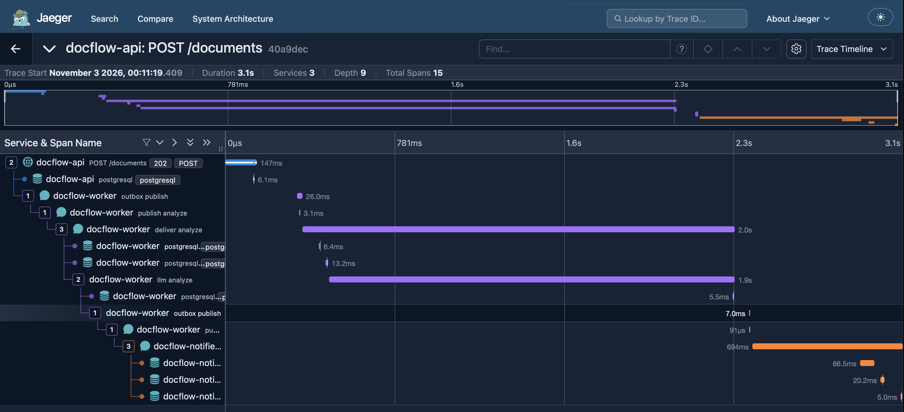

# 09 — Distributed tracing with OpenTelemetry and Jaeger

All three services export traces over OTLP to Jaeger (`localhost:4317`, UI on `localhost:16686`). `AddTracing` in `DocFlow.Messaging` registers the shared setup: our own `DocFlow` activity source, Npgsql's built-in `Npgsql` source, RabbitMQ.Client instrumentation (publish / deliver spans, context propagated in the `traceparent` message header), and ASP.NET Core instrumentation in the API.

## Why the outbox breaks the trace

Without extra work, one document produced two unrelated traces. The `POST /documents` trace ended at the `INSERT` into `documents` and `outbox_messages`; the publish to RabbitMQ started a new trace.

The trace context lives in `Activity.Current` only while the HTTP request is being handled. The request writes the outbox row and returns `202`; the context is gone. The relay picks the row up later, in its own background loop, where there is no current activity — so the publish has no parent. The table carried the message, but not the context.

Fix: the context is stored in the row.

1. `OutboxMessage.TraceParent` is filled from `Activity.Current?.Id` when the row is created (migration `OutboxTraceParent`).
2. The relay opens an `outbox publish` producer span per message with `TraceParent` as the parent.
3. RabbitMQ.Client instrumentation writes that context into the `traceparent` header; the consumer continues the same trace.

Events from the worker get their parent the same way: their outbox rows are created while a delivery is being handled, so `Activity.Current` is the `deliver` span.

Which relay publishes a row doesn't matter: the API and the worker share the outbox table, and in the traces some commands were published by the worker's relay and some events by the API's. The context is in the row, not in the process.

## One document, one trace

`policy-1.txt`, 3.1 s, 15 spans across `docflow-api`, `docflow-worker` and `docflow-notifier`:

`POST /documents` → `INSERT` → `outbox publish` → `publish analyze` → `deliver analyze` → `llm analyze` → `UPDATE` + outbox row → `outbox publish` → `publish document.analyzed` → `deliver document.analyzed` in the Notifier.

| Part | Time | Share |
|---|---|---|
| `llm analyze` (fake LLM) | 1.9 s | ~61 % |
| Notifier, including the first database connection after start (`CONNECT` 66 ms) | 694 ms | ~22 % |
| Relay pick-up after the HTTP response | ~0.2 s | ~6 % |
| HTTP request + `INSERT` | 147 ms | ~5 % |
| Broker and outbox: two `outbox publish`, `publish`, worker's database calls | ~60 ms | ~2 % |

The broker itself costs milliseconds. The LLM dominates, and with a real model it dominates more. The relay pick-up delay is between 0 and 1 s depending on where in the polling interval the row lands.

## Retries in the trace

`transient.txt`: one `deliver analyze` of 8.2 s. The fake LLM failed and Polly retried inside the same delivery until a call succeeded; the message never went to the retry queue.

`down.txt`: one trace of about 57 s with **four** `deliver analyze` spans, all children of the same `publish analyze`, about 10 s apart — the first delivery and three redeliveries through the retry queue. The `traceparent` header survives dead-lettering and the TTL queue unchanged, so the redeliveries stay in the original trace. Each delivery holds 5.7–7.2 s of LLM calls (three Polly attempts), 12 calls in total. The last delivery is followed by the `UPDATE` to `Failed`, the publish to `docflow.dlq` and the `document.failed` event reaching the Notifier. About 27 s of the 57 s are LLM calls, about 30 s are retry-queue delays.

`poison.txt`: one delivery, one 1.2 s LLM call, no retries, then `Failed`, the DLQ publish and the `document.failed` event.

## Making failures visible

The first version of the spans didn't show failures: the `llm analyze` span was disposed without a status, and the consumer catches every exception itself, so the RabbitMQ instrumentation saw an ordinary delivery. A failed document looked like a slow successful one.

Changes:

- `llm analyze` is opened inside the Polly callback, one span per attempt, tagged `delivery.attempt` and `llm.attempt`. A failed attempt gets status `Error` and an `exception` event (`ActivityExtensions.RecordError`).
- The `deliver analyze` span is marked `Error` when the delivery fails, both for a retry and for the final give-up.

In Jaeger, failed documents are now found with the tag filter `error=true`.

## Polling noise

Every relay poll ran a `SELECT ... FOR UPDATE SKIP LOCKED` with no parent, so each second produced a separate one-span trace from each relay. The relay now runs its database work inside `SuppressInstrumentationScope`, and turns instrumentation back on only for the per-message `outbox publish`. Only traces that belong to a document remain.
